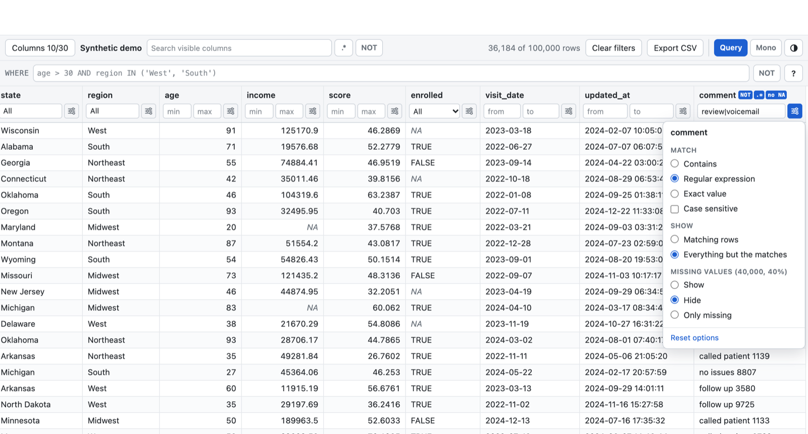

# pqview

[](https://github.com/jossammil/pqview/actions/workflows/R-CMD-check.yaml)
[](https://github.com/jossammil/pqview/actions/workflows/js.yaml)

A fast, serverless viewer for data frames and parquet files. `pqview` embeds
your data as compressed parquet inside **one HTML file** and reads it in the
browser, so the result opens by double-click, can be emailed or dropped on a
shared drive, and needs no R session, server or internet connection.



## Install

On any machine with R 4.2 or later (macOS, Windows or Linux):

```r
install.packages("remotes")
remotes::install_github("jossammil/pqview")
```

pqview is pure R plus prebuilt JavaScript, so no Rtools, Xcode or Node is
needed to install it.

## Use

```r
library(pqview)

# In the RStudio viewer or a browser
pqview(mtcars)

# From a parquet file, choosing which columns show first
pqview("big_table.parquet", columns = c("id", "state", "amount"))

# One portable file
save_pqview(my_data, "my_data.html", title = "My data", open = TRUE)

# Start with a query, a monospace font and a dark theme
pqview(mtcars, where = "mpg > 25 OR cyl = 8", font = "mono", theme = "dark")
```

It is an htmlwidget, so it also works in R Markdown and Quarto chunks
(use `embed-resources: true` for a single-file document) and in Shiny with
`pqviewOutput()` / `renderPqview()`.

## What the page does

- **Column picker.** Every column is listed with its type and, once read,
  its distinct count, share of missing values and range. Search the list and
  tick the columns you want.
- **Per-column filters** under each header: min/max for numbers, from/to for
  dates (`2024`, `2024-03` or `2024-03-15` all work), a checklist for factors
  and low-cardinality text, a text box for other text, and TRUE/FALSE for
  logicals.
- **Filter options** (the sliders button in each header):
  - *Match*: contains, regular expression, or exact value, optionally case
    sensitive.
  - *Show*: matching rows, or **everything but** the matches. Inverting gives
    the true complement, so rows where that column is missing are included
    (normal + inverted always add up to every row).
  - *Missing values*: show, hide, or show only missing.
  - Options in effect appear as badges next to the column name (`NOT`, `.*`,
    `Aa`, `no NA`).
- **Value finder with regex.** A checklist's "Find value" box has a `.*`
  toggle; "Only these" checks just the values that match.
- **WHERE query bar.** A SQL condition over any column, shown or not, applied
  on top of the column filters. `NOT` inverts it; `?` lists examples.
- **Global search** across the visible columns, with `.*` (regular
  expression) and `NOT` toggles.
- **Sorting.** Click a header to sort; shift-click to add more sort keys.
  Missing values always sort last.
- **Export CSV** of the filtered rows and visible columns, at full precision.
- **Switches** for the theme (auto, light, dark), a monospace font, and
  showing the query bar. Each reader's choices are remembered in their
  browser.
- When the viewer fills a page of its own, it leaves `top_offset` pixels
  (default 56) above the toolbar, so browser chrome such as Safari's
  full-screen toolbar does not cover it.

### WHERE syntax

| | |
|---|---|
| Compare | `age > 30`, `region = 'West'`, `age != 40`, `income / 1000 >= 50` |
| Combine | `AND`, `OR`, `NOT`, parentheses |
| Lists and ranges | `region IN ('West', 'South')`, `age NOT BETWEEN 30 AND 40` |
| Text patterns | `comment LIKE '%review%'` (`%` any text, `_` one character, ignores case) |
| Regular expressions | `comment REGEXP '^(called\|left)'` (case-sensitive), `IREGEXP` or `~*` to ignore case |
| Missing values | `income IS NULL`, `comment IS NOT NULL` |
| Dates | `visit_date BETWEEN '2023-01' AND '2023-06'`, `updated_at = '2024-03-10'` (a date covers the whole period, in the column's time zone) |
| Functions | `LOWER`, `UPPER`, `LENGTH`, `ABS`, `YEAR`, `MONTH`, `DAY` |
| Logical columns | `enrolled AND NOT flagged` |
| Odd column names | `"column with spaces" = 1` or `` `Sepal.Length` > 5 `` |

Comparisons with a missing value are unknown, as in SQL, so `age > 30` never
matches a missing age. The query bar's `NOT` keeps everything the condition
does not match, including those rows.

## How it stays fast

The page lists columns from the parquet footer without decoding any data,
decodes only the columns you select (the rest are read in idle time), keeps
them in typed arrays, and draws only the rows on screen. On a 100,000 x 30
table (11 MB file) in Chrome on a laptop:

| Step | Time |
|---|---|
| Column list ready | ~5 ms |
| First table drawn | ~125 ms |
| Numeric, date or category filter | 1-5 ms |
| Text "contains", regex or global search | 5-20 ms |
| WHERE query | 5-10 ms |
| Sort a numeric column | ~30 ms |
| Redraw while scrolling | < 1 ms |

## Limits

- Everything is held in browser memory, which is what makes it instant. It is
  built for tables up to a few hundred thousand rows; `pqview()` warns when
  the embedded data passes 50 MB.
- The HTML file is about 1.33x the parquet size plus roughly 100 KB.
- List columns are shown as JSON text. Parquet files that use codecs other
  than snappy, or that have nested columns, are rewritten on the R side first.
- Date-times are shown in the column's time zone, to the millisecond.
- The query bar filters rows; it has no `SELECT`, `GROUP BY` or aggregates.

## Development

The browser code lives in `srcjs/` and is bundled with
[hyparquet](https://github.com/hyparam/hyparquet) into
`inst/htmlwidgets/lib/pqview/pqview-core.js`. The bundle is committed, so
Node is only needed to change the JavaScript.

```bash
cd srcjs
npm install
npm test         # unit tests for the store, filters, query parser, CSV and loader
npm run build    # rebuild the bundle
```

```r
devtools::test()                      # R tests
source("examples/make-demo.R")        # writes examples/demo.html (100k x 30)
```

End-to-end tests drive the demo page in a real browser and compare every
row count with the same filters applied in R:

```bash
cd srcjs
npm run e2e                             # Chromium (uses installed Chrome if present)
npx playwright install webkit && BROWSER=webkit npm run e2e   # Safari's engine
```

GitHub Actions runs `R CMD check` on macOS, Windows and Linux, installs the
package with `remotes::install_github()` on macOS and Windows, and runs the
JavaScript and browser tests.
